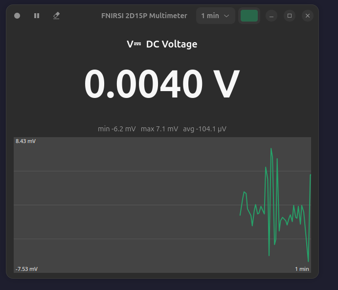
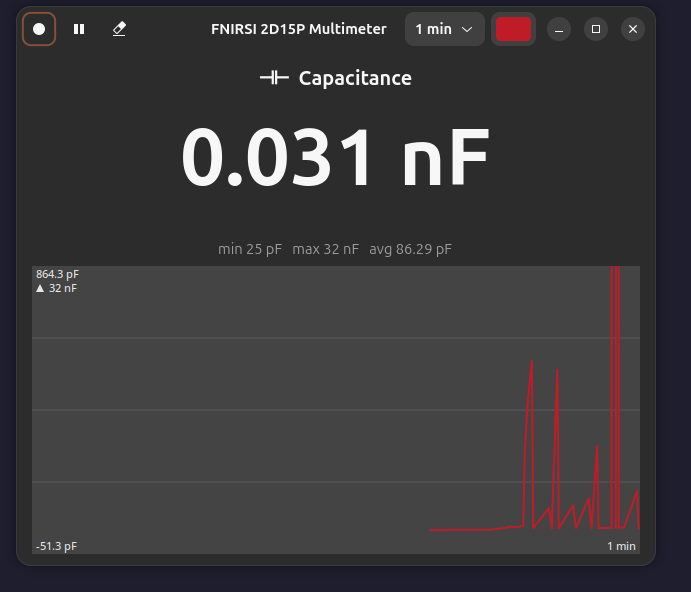
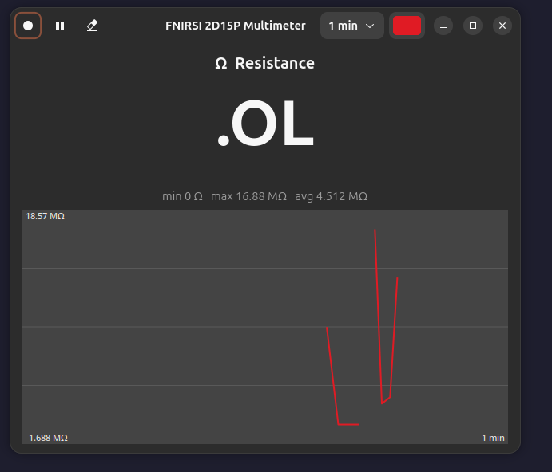

# FNIRSI 2D15P Multimeter GUI

A native GNOME (GTK 4 / libadwaita) live viewer for the **FNIRSI 2D15P** multimeter.
It shows the readings that the modded firmware streams over USB: a large value with
the function and unit, min/max/avg, a scrolling chart, and CSV recording.

> **Requires the mod firmware.** Stock FNIRSI firmware streams nothing. The
> `dmm-stream` patch (mod 1.3 or newer) from
> **[giray/fnirsi-2d15p-mod](https://github.com/giray/fnirsi-2d15p-mod)** adds it.
> That repository also contains the udev rule, the protocol notes and a command-line
> reader (`host/dmm_read.py`).



| Capacitance, spike left off-scale (`▲ 32 nF`) | Resistance, overload (`.OL`) |
|---|---|
|  |  |

## Features

- Live reading in the device's own digits, with function icons (`V⎓`, `V~`, `Ω`, …)
  and a HOLD indicator. Overload is shown as the device shows it (`.OL`).
- Session min / max / average, reset when the function changes or on Clear.
- Scrolling chart with a configurable window (30 s to 6 h) and trace colour; both are
  remembered in `~/.config/fnirsi-dmm-gui/config.json`. The axis ignores short spikes so
  millivolt detail stays visible; off-scale peaks are flagged with `▲`/`▼` and their true value.
- CSV recording to `~/Documents` (same columns as `dmm_read.py`, repeated readings collapsed).
- Pause, Clear, automatic reconnect, and clear status banners (no device,
  permission denied, connected but silent).
- **Read-only:** the app never writes anything to the device.

## Install

```bash
sudo apt install python3-gi gir1.2-gtk-4.0 gir1.2-adw-1      # Debian/Ubuntu names
git clone https://github.com/giray/fnirsi-2d15p-gui.git && cd fnirsi-2d15p-gui
python3 -m venv --system-site-packages .venv && . .venv/bin/activate
pip install -e .
fnirsi-dmm-gui                      # or: python3 -m fnirsi_dmm_gui
./install.sh                        # optional: GNOME app-grid launcher + icon
```

Serial access: install the udev rule from the mod repository (`host/99-fnirsi-2d15p.rules`)
and replug, or add yourself to `plugdev`/`dialout`.

On the device, show the **Multimeter** page and turn **USB Sharing off** (it must
enumerate as a serial port, not a USB drive).

Options: `--port /dev/ttyACM0` to skip auto-detection.

## Troubleshooting

| Banner / symptom | Cause and fix |
|---|---|
| *No device found* | Cable, mod firmware, or USB Sharing is on. |
| *Permission denied* | Install the udev rule or join `plugdev`/`dialout`, then replug. |
| *Connected but no data* | Device not on the Multimeter page, or the firmware's stream stalled after a USB reconnect. Leave and re-enter the page; if still silent, power-cycle the device. `dmm_read.py` behaves identically, so this is a firmware limitation. |
| `---` in the big display | The device is autoranging and sends a blank value; the chart and stats are left untouched. |

## Development

```bash
pip install -e '.[dev]'
pytest        # the reader tests use pseudo-terminals, no hardware needed
```

More in [docs/](docs/): [usage](docs/usage.md), [architecture and protocol](docs/architecture.md).

## Licence

GPL-3.0-or-later, the same as the mod repository. See [LICENSE](LICENSE).
